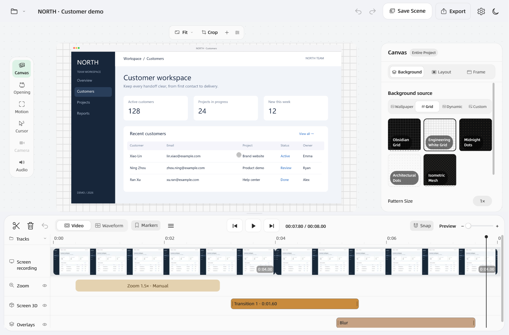
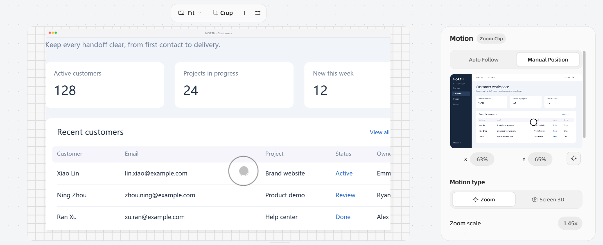
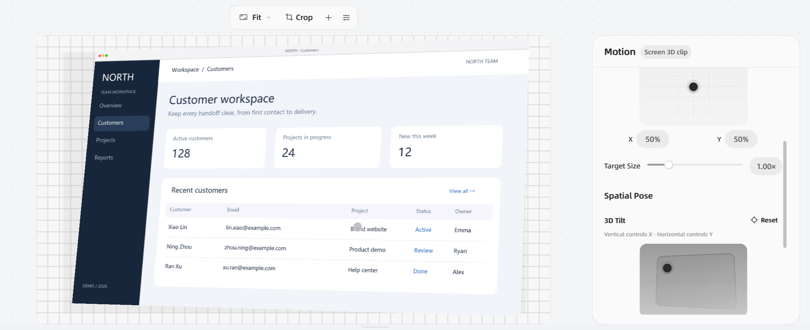
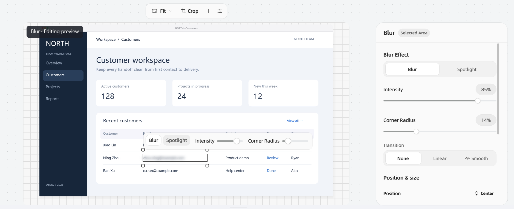
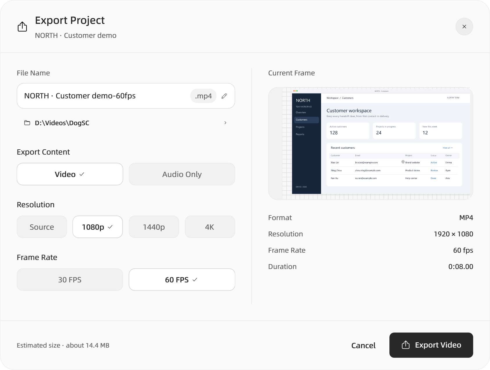

<p align="center">
  
</p>
<h1 align="center">WinDogSC</h1>
<p align="center"><a href="README.md">简体中文</a> · <strong>English</strong></p>
<p align="center">Turn screen actions into videos that explain.</p>
<p align="center">DogSC for Windows · Record, edit, animate, and export</p>
<p align="center">
  
  
  <a href="LICENSE"></a>
</p>
<p align="center">
  <a href="#get-started">Get started</a> ·
  <a href="windows/README.md">User guide (Chinese)</a> ·
  <a href="windows/MAC_PARITY.md">Mac feature comparison (Chinese)</a> ·
  <a href="https://github.com/coffe01-10/windogsc/issues">Report an issue</a>
</p>



WinDogSC is for product demos, tutorials, and bug reports: record your actions, cut the waiting, guide attention to the important parts, and export a finished video. Based on the product design of [laogou717/DogSC](https://github.com/laogou717/dogsc), it brings the desktop workflow to Windows with .NET 8 / WPF.

These screenshots were captured from the current Windows app on **2026-10-11** as **lossless PNGs at 2× pixel density**. Click an image to view the original. The NORTH customer workspace uses fictional demo data. The app window and executable retain the **DogSC** name. Switch languages under **Settings → General → Language**.

## Launch film

https://github.com/user-attachments/assets/3c5d73f9-e42f-4c88-be03-00b7a0ee2208

62 seconds · 1080p / 60 FPS · Original Chinese film

## Recording starts with a floating toolbar

Choose a display, window, or custom region, then enable your microphone, system audio, and camera picture-in-picture as needed. A camera or capture card can also serve as the main source. Pause and resume to keep the recording on one timeline.

- **Keep the toolbar close**: drag, collapse, or expand it; adjust its size from 70% to 110%, or use `Ctrl` + mouse wheel. Release near a screen edge to dock it. It runs horizontally at the top and bottom, vertically at the sides, and expands toward available space.
- **Keep your notes handy**: move the memo, change its font size and opacity. The recording toolbar, countdown, and memo are excluded from screen capture.
- **Leave editing cues**: `Ctrl+Alt+M` adds a recording marker; `Ctrl+Alt+S` stops recording.
- **Continue in the editor**: the completion card shows a first-frame thumbnail and links to the editor and project folder. Interrupted recordings can be scanned for recoverable media.

System audio captures the current playback device. Microphone and camera access require the corresponding Windows privacy permissions for desktop apps.

## Editing and motion help viewers follow

The left rail has six sections: **Canvas, Opening, Motion, Cursor, Camera, and Audio**. Cursor, Camera, and Audio are disabled when their source media is absent. The floating toolbar above the preview controls aspect ratio, cropping, local effects, and preview quality. The inspector on the right follows your selection.

Split, trim, reorder, and retime clips on the timeline. Thumbnails, audio waveforms, markers, and edge snapping help you find the right moment. Zoom, screen 3D, camera motion, and overlays have separate tracks that can be collapsed. Audio supports both global mixing and per-clip volume, mute, and inheritance from global settings.

**Canvas** has three tabs: **Background / Layout / Frame**. Choose wallpapers, five grids, three animated backgrounds, or a custom image or video. Adjust padding, 2D position, content scale, corners, shadow, and border. Add light or dark window, browser, phone, or tablet frames. The aspect-ratio card offers landscape and portrait presets plus custom dimensions; source cropping has eight handles and pixel inputs for all four edges.



**Automatic zoom** follows the pointer continuously by default: the central stable region keeps the framing, and crossing its boundary starts smooth spring following. Click grouping is also available: nearby clicks keep the framing, movement across regions shifts the focus smoothly, and sustained activity extends the hold. Regenerating automatic shots preserves manual ones. You can also set focus, scale, entrance and exit durations, and linear, smooth, spring, quadratic, cubic, or custom Bézier easing.

Switch between **Zoom / Screen 3D** in Motion; both kinds of clips can coexist. Screen 3D controls position, target size, tilt, rotation, and perspective, along with focus-band size, softness, strength, and direction. Selecting a clip while paused shows its target framing; playback follows the timeline.



**Opening** offers converge, slide, and gentle 3D styles, with rhythm, duration, element spacing, and ordering. Cursor options include the system pointer, a touch dot, or hidden mode, plus animated click previews, click feedback, idle hiding, and timing calibration. Move and resize camera picture-in-picture directly, adjust its shape, internal framing, mirroring, and entrance and exit animations, and set a global offset or individual sync anchors. Save combined screen/camera layouts in the camera panel and apply them as linked animations at the playhead; same-name replacement and deletion are supported.

Click a numeric parameter pill to type a value. Confirming creates one undo step; `Esc` discards the draft. Scene presets can be saved, updated, made default, or deleted while keeping current media and timeline edits. Applying a crop across different source sizes first shows the adapted bounds. New recordings use the default scene, or the most recently used static appearance when no default is set.

## Local effects hide details and highlight the point



Click **＋ → Blur or Spotlight** above the preview and draw a region, then switch between blur and spotlight in the inspector. Add stickers with **Import Sticker…** or **Paste Image**. Select the corresponding timeline clip to edit it again.

Blur and spotlight regions can be drawn, moved, resized from edges or corners, and redrawn. Regions follow source cropping, zoom, and perspective. A floating toolbar above the selection controls strength. For precision, enter source pixel coordinates or nudge with the arrow keys.

Each effect has its own time range and fades. Overlapping effects occupy separate timeline rows. Stickers support rotation, opacity, and layer ordering; effects support copy, paste properties, and undo. A selected effect shows an editing preview while paused so you can adjust the whole region; playback follows the timeline.

## Export video or audio



| Output | Options |
| --- | --- |
| Video | MP4, source size / 1080p / 1440p / 4K, 30 / 60 FPS |
| Audio only | M4A, mixing the project's system audio and microphone |
| Export process | Preparation, progress, elapsed time, estimated time remaining, and cancellation |

Export options are saved with the project. An existing file is replaced only after a successful export; cancelling or failing preserves the previous video. Preview and export use the same motion paths and effect parameters.

## Get started

The current entry point is **running from source**; the repository does not yet provide a release package. Windows 10 version 2004 or later is supported. The build target is `win-x64`.

Install the [.NET 8 SDK](https://dotnet.microsoft.com/download/dotnet/8.0) and [FFmpeg](https://ffmpeg.org/download.html). Both `ffmpeg.exe` and `ffprobe.exe` are required. Add their directory to `PATH`, or select `ffmpeg.exe` in the app settings after launch.

```powershell
git clone https://github.com/coffe01-10/windogsc.git
cd windogsc
dotnet run --project windows/src/DogSC.App
```

Try your first recording:

1. Choose a display or region in the recording toolbar, record a short interaction, stop, and select **Open Editor** on the completion card.
2. Trim the initial waiting, then open **Motion → Zoom** and generate automatic zoom from clicks.
3. Click **＋ → Blur or Spotlight**, draw over the information you want to blur, and play back to check the region and timing.
4. Click **Export**, choose MP4 and a resolution, then open the finished video.

Projects are saved by default under **Videos / DogSC**. Each `.dogscproject` folder contains project data and media. Keep the entire folder to continue editing later.

You can also specify FFmpeg with the `DOGSC_FFMPEG` environment variable, or place it alongside `ffprobe.exe` in the app directory. For devices, shortcuts, and troubleshooting, see the [Windows user guide (Chinese)](windows/README.md).

## Relationship to the original

This project continues the Windows implementation of DogSC while retaining the original **record → edit and animate → export** workflow. This repository tracks the Windows implementation in `windows/`; the macOS Swift source is available in the [upstream repository](https://github.com/laogou717/dogsc). Local macOS reference source, build configuration, and platform-specific resources are ignored by Git. Shared icons, fonts, and copyright notices are retained. Building the Windows app requires neither Xcode nor Apple signing certificates.

The recording toolbar offers **Import macOS Project…**. It converts screen, audio, camera, cursor paths, markers, and some editing, motion, and effect settings. Unsupported content is reported in a migration summary. The platforms use different project formats; a converted Windows project cannot be used directly as a native Mac project.

Some differences remain:

- Window recording uses native Windows capture and follows obscured, moved, and resized windows. Minimizing or closing the target retains its last frame.
- Independent screen and camera motion tracks, custom Bézier easing, and motion-clip copying are implemented. Screen 3D, opening scale, and camera layouts evaluate at the output frame rate, with continuously changing camera shapes and corner radii. Linked screen/camera clips move and resize together with one-step undo. Mac imports retain layout pairs, camera sizing based on the short edge, edge docking, size during zoom, and camera border/shadow settings; older Windows projects retain their composition. The camera panel offers separate outer-border and shadow controls, with the border fading continuously on entering fullscreen. Saved combined layouts and continuous pointer following are implemented; other complex combinations, global motion compatibility, and rendering details are still being refined.
- Sticker appearance and animation, camera sync anchors, recovery of cut gaps, and interrupted-recording recovery are implemented. Recovery journals preserve clip identities, markers, sources, and frame rate; segmented recordings can recover media already written to disk. Radial focus, dimming, and pointer, motion, or fixed focus targets are implemented; direct canvas editing is still being refined. Native iPhone/iPad capture is outside the port's scope.
- Complex Mac projects cannot be migrated fully. WPF preview and FFmpeg export may still differ in antialiasing, blur, and shadow details.

See the [Windows/macOS feature comparison](windows/MAC_PARITY.md) for implementation status and remaining work, and the [video feature notes](windows/VIDEO_PARITY.md) and [layout review](windows/VIDEO_LAYOUT.md) for recent interaction and UI checks. These detailed documents are in Chinese.

## Development and builds

```powershell
dotnet build windows/DogSC.sln -c Release
dotnet test windows/tests/DogSC.Core.Tests
```

The app self-test generates demo media, verifies export and project migration, and captures **one second of the desktop**. It removes its temporary files when finished:

```powershell
dotnet run --project windows/src/DogSC.App -- --self-test
```

Create a local Windows x64 publish directory:

```powershell
dotnet publish windows/src/DogSC.App/DogSC.App.csproj -c Release -r win-x64 --self-contained false -o artifacts/publish
.\artifacts\publish\DogSC.exe
```

This publish configuration requires the **.NET 8 Desktop Runtime** and FFmpeg / ffprobe. FFmpeg is not bundled. See the [Windows workflow](.github/workflows/windows.yml) for automated builds and draft releases.

## Contributing and license

Report bugs and share usage feedback through [Issues](https://github.com/coffe01-10/windogsc/issues). For interaction problems, include reproduction steps, expected behavior, and actual results. Screenshots or short videos help reproduce the issue.

Thanks to [laogou717](https://github.com/laogou717) for the original [DogSC](https://github.com/laogou717/dogsc). This project inherits upstream design, brand assets, and source history. It is open source under the [MIT License](LICENSE), retaining the original copyright notices. See the [font credits](Resources/Fonts/README.md) and [README asset sources](docs/images/windows/SOURCES.md) for asset attribution.
