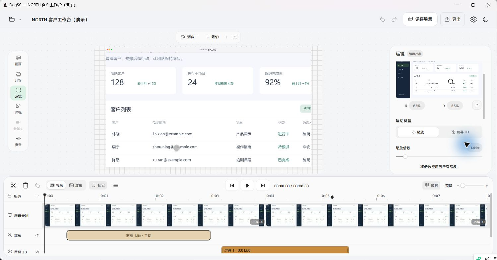
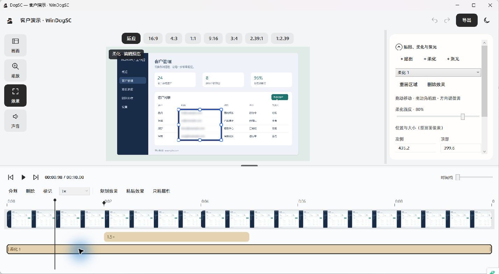

<p align="center">
  
</p>
<h1 align="center">WinDogSC</h1>
<p align="center">把屏幕操作，变成讲得清楚的视频。</p>
<p align="center">DogSC 的 Windows 桌面版 · 录制、剪辑、运镜与导出</p>
<p align="center">
  
  
  <a href="LICENSE"></a>
</p>
<p align="center">
  <a href="#开始使用">开始使用</a> ·
  <a href="windows/README.md">详细使用说明</a> ·
  <a href="windows/MAC_PARITY.md">与 Mac 版的功能差异</a> ·
  <a href="https://github.com/coffe01-10/windogsc/issues">反馈问题</a>
</p>


WinDogSC 面向产品演示、操作教程和问题复现：录下操作，去掉等待，把镜头引向重点，再导出成片。它基于 [laogou717/DogSC](https://github.com/laogou717/dogsc) 的产品设计，使用 .NET 8 / WPF 实现 Windows 桌面流程。

本页截图来自当前 Windows 程序；画面中的客户表格是虚构演示数据。应用窗口和可执行文件仍使用 **DogSC** 名称。

## 录制：从一个悬浮工具条开始

选择显示器、窗口或自选区域，按需开启麦克风、系统声音和摄像头画中画；也可以把摄像头或采集卡作为主画面。暂停后继续录制，素材会接入同一条时间线。

- **工具条跟着工作空间走**：拖动、收起与展开，支持 70%–110% 大小调节和 `Ctrl` + 滚轮缩放；靠近四边松手吸附，上下横排、左右竖排，展开方向随可用空间调整。
- **讲解时保留提示**：可拖动备忘录、调整字号与透明度；录制条、倒计时和备忘录从屏幕采集中排除。
- **给后期留路标**：`Ctrl+Alt+M` 添加录制标记，`Ctrl+Alt+S` 停止录制。

系统声音录的是当前播放设备的声音。使用麦克风或摄像头时，需要 Windows 隐私设置允许桌面应用访问相应设备。

## 编辑与运镜：让观众跟上操作

在时间线上分割、裁短、重排和变速，用缩略图、音频波形、标记和边缘吸附定位。画面支持留白、圆角、阴影、壁纸、源画面裁切、自定义比例和透视倾斜，也可以保存为自己的场景预设。



**按点击自动运镜**会把连续操作组织成镜头：附近点击保持构图，跨区域时平滑移动，持续操作延长停留。重新生成自动镜头会保留手动镜头；也可以手动设置焦点、倍数、进入与退出时长，选择线性、平滑、弹簧、二次、三次或自定义贝塞尔曲线。

光标可显示为箭头、圆点或隐藏，支持点击反馈、静止隐藏和时间校准。摄像头画中画可直接移动、缩放，调整形状、内部构图、镜像和进出动画。

## 局部效果：遮住信息，突出重点



在「效果」页添加柔化、聚光或贴图。柔化与聚光支持直接框选、移动、拖边角缩放和重画，区域随源画面的裁切、缩放与透视变化。需要精细定位时，可以输入原画面像素坐标，或用方向键微调。

每个效果都有独立时间范围和淡入淡出；重叠效果会在时间线上分行。贴图支持旋转、透明度和图层顺序，效果可以复制、粘贴属性并撤销。暂停选中效果时会显示「编辑预览」，方便完整调整区域；播放时按时间线呈现。

## 导出：交付视频或音频

| 内容 | 可选设置 |
| --- | --- |
| 视频成片 | MP4，原始尺寸 / 1080p / 1440p / 4K，30 / 60 FPS |
| 仅音频 | M4A，按项目的系统声音与麦克风混音 |
| 导出过程 | 准备阶段、进度、已用时间与剩余时间估算，可取消 |

导出选项随项目保存。同名文件在新导出成功后才替换；取消或失败时保留旧成片。预览和导出使用相同的运镜轨迹与效果参数。

## 开始使用

目前以**源码运行**为入口，仓库尚未提供发布包。Windows 构建目标为 `win-x64`。

准备 [.NET 8 SDK](https://dotnet.microsoft.com/download/dotnet/8.0) 和 [FFmpeg](https://ffmpeg.org/download.html)。需要同时具备 `ffmpeg.exe` 与 `ffprobe.exe`；把它们所在目录加入 `PATH`，或者启动后在应用设置中指定 `ffmpeg.exe`。

```powershell
git clone https://github.com/coffe01-10/windogsc.git
cd windogsc
dotnet run --project windows/src/DogSC.App
```

第一次体验：

1. 在录制条选择一个显示器或区域，录制一小段操作后停止，在完成卡片中点击「打开编辑器」。
2. 在编辑器中裁掉开头等待，打开「缩放」页生成按点击自动运镜。
3. 在「效果」页框选需要柔化的区域，播放检查范围和时间。
4. 点击「导出」，选择 MP4 和所需分辨率，导出后打开成片。

录制项目默认保存在「视频 / DogSC」目录下，扩展名为 `.dogscproject` 的文件夹中包含项目数据与素材。保留整个文件夹，后续可以继续编辑。

FFmpeg 也可通过 `DOGSC_FFMPEG` 环境变量指定，或与 `ffprobe.exe` 一起放在程序目录。更多设备、快捷键与排障说明见 [Windows 使用文档](windows/README.md)。

## 与原版的关系

这里继续完善 DogSC 的 Windows 体验，保留原版“录制 → 编辑与运镜 → 导出”的使用主线。上游 Swift 源码位于 `Sources/`；Windows 实现位于 `windows/`，构建 Windows 版无需 Xcode 或 Apple 签名证书。

录制条提供「导入 macOS 项目…」，可转换屏幕、音频、摄像头、光标轨迹、标记及部分剪辑、运镜和效果设置；未支持的内容会显示迁移摘要。两端项目格式不同，转换后的 Windows 项目不能直接作为 Mac 原生项目使用。

以下差异仍然存在：

- 窗口录制按屏幕矩形采集，窗口移动或被遮挡时，与 Mac 原生窗口采集行为不同。
- 已加入独立屏幕 / 摄像头运动轨道和自定义贝塞尔曲线；运动成片目前按 15Hz 分段逼近，摄像头圆角遮罩尚不随布局连续变形。连续光标跟随控制器仍未完整移植。
- 已加入贴图边框、阴影、背景虚化、进出动画、分段摄像头同步、剪切缺口恢复和中断录制扫描恢复。运动轨道的独立效果复制、录制恢复日志与 iOS 设备镜像仍待补齐。
- 复杂 Mac 项目不能完整迁移；WPF 预览与 FFmpeg 导出在抗锯齿、模糊和阴影细节上仍可能有差异。

逐项实现状态、验证记录和剩余工作见 [Windows 与 macOS 功能核对](windows/MAC_PARITY.md)。

## 开发与构建

```powershell
dotnet build windows/DogSC.sln -c Release
dotnet test windows/tests/DogSC.Core.Tests
```

应用自检会生成演示素材、验证导出和项目迁移，并采集 **1 秒桌面画面**；完成后清理自检临时文件：

```powershell
dotnet run --project windows/src/DogSC.App -- --self-test
```

生成本地 Windows x64 发布目录：

```powershell
dotnet publish windows/src/DogSC.App/DogSC.App.csproj -c Release -r win-x64 --self-contained false -o artifacts/publish
.\artifacts\publish\DogSC.exe
```

该发布方式依赖 **.NET 8 Desktop Runtime**，也需要 FFmpeg / ffprobe；发布目录不捆绑 FFmpeg。自动构建与草稿发布流程见 [Windows 工作流](.github/workflows/windows.yml)。

## 贡献与许可

欢迎通过 [Issues](https://github.com/coffe01-10/windogsc/issues) 提交问题或使用体验。涉及交互问题时，请说明操作步骤、预期行为与实际结果；截图或短视频有助于复现。

感谢 [神烦老狗 / laogou717](https://github.com/laogou717) 的原版 [DogSC](https://github.com/laogou717/dogsc)。本项目继承上游的设计、品牌素材和源码历史，按 [MIT License](LICENSE) 开源，保留原作者版权声明。内置字体的来源及许可见 [字体说明](Resources/Fonts/README.md)；本页图片来源见 [README 素材说明](docs/images/windows/SOURCES.md)。
