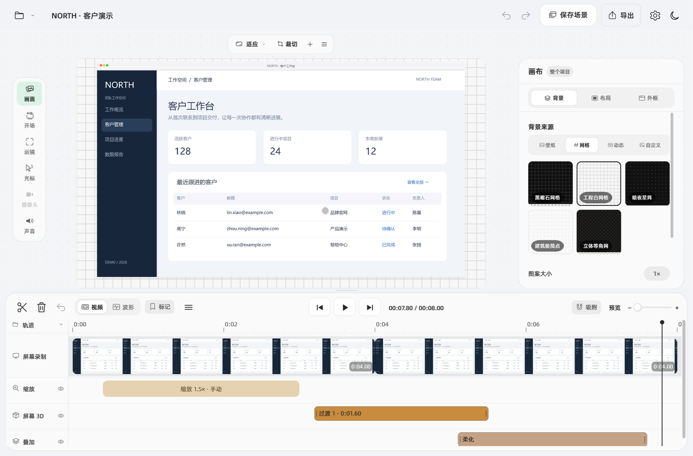
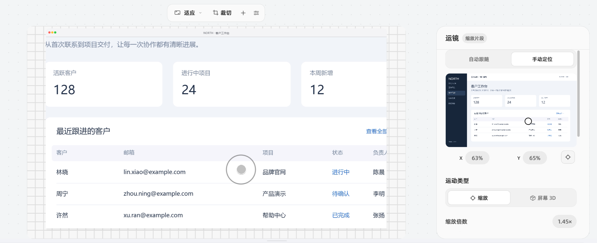
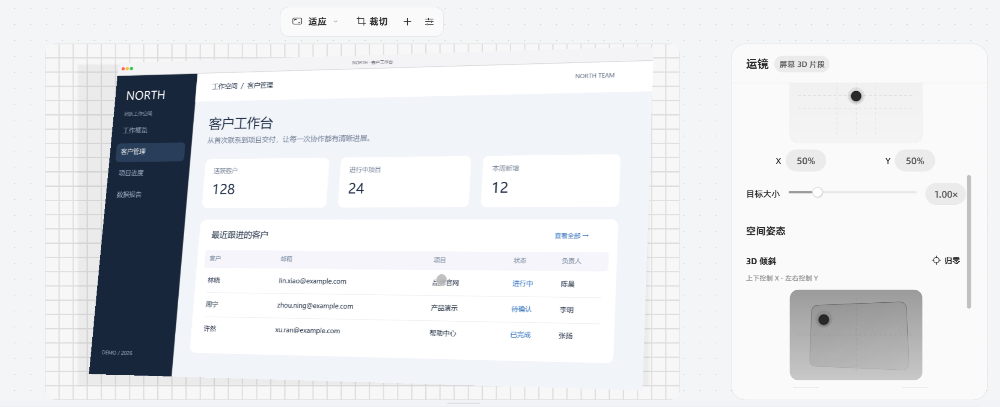
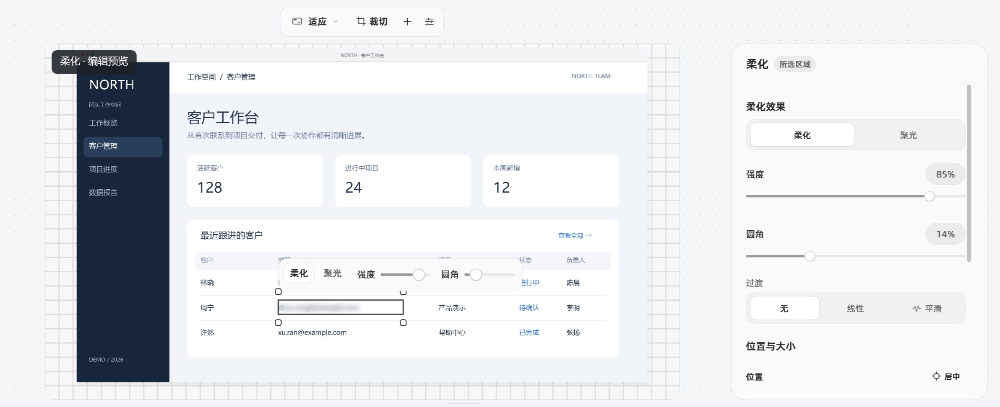
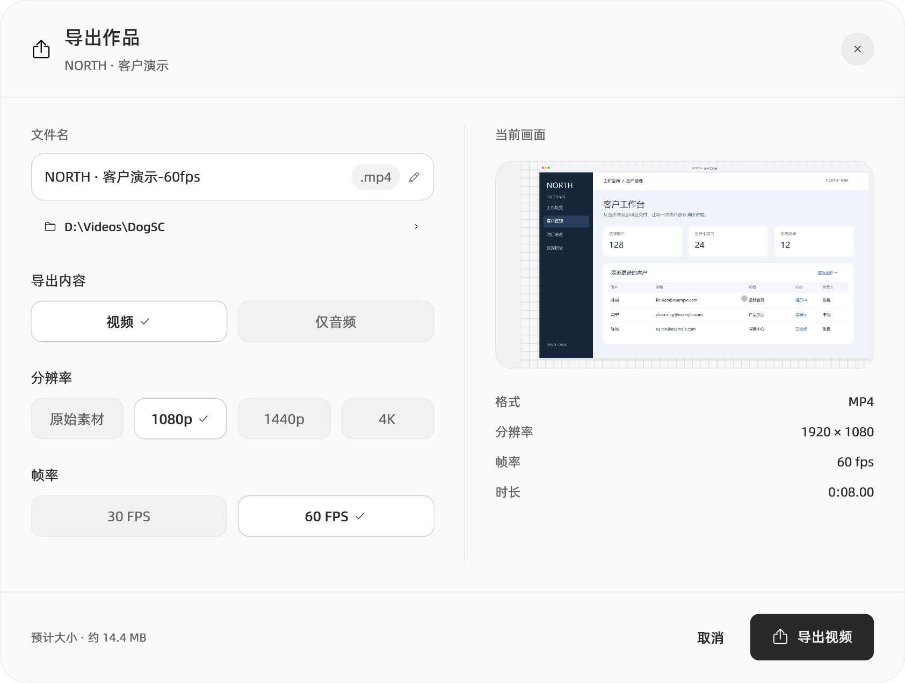

<p align="center">
  
</p>
<h1 align="center">WinDogSC</h1>
<p align="center"><strong>简体中文</strong> · <a href="README.en.md">English</a></p>
<p align="center">把屏幕操作，变成讲得清楚的视频。</p>
<p align="center">DogSC 的 Windows 桌面版 · 录制、剪辑、运镜与导出</p>
<p align="center">
  
  
  <a href="LICENSE"></a>
</p>
<p align="center">
  <a href="#开始使用">开始使用</a> ·
  <a href="windows/README.md">详细使用说明</a> ·
  <a href="windows/MAC_PARITY.md">与 Mac 版的功能差异</a> ·
  <a href="https://github.com/coffe01-10/windogsc/issues">反馈问题</a>
</p>



WinDogSC 面向产品演示、操作教程和问题复现：录下操作，去掉等待，把镜头引向重点，再导出成片。它基于 [laogou717/DogSC](https://github.com/laogou717/dogsc) 的产品设计，使用 .NET 8 / WPF 实现 Windows 桌面流程。

本页截图于 **2026-10-11** 从当前 Windows 程序以 **2× 像素密度、无损 PNG** 重新采集，点击图片可查看原图；画面中的 NORTH 客户工作台是虚构演示数据。应用窗口和可执行文件仍使用 **DogSC** 名称。在「设置 → 通用 → 语言」中可切换中文 / English。

## 宣传视频

https://github.com/user-attachments/assets/3c5d73f9-e42f-4c88-be03-00b7a0ee2208

62 秒 · 1080p / 60 FPS · 中文原片

## 录制：从一个悬浮工具条开始

选择显示器、窗口或自选区域，按需开启麦克风、系统声音和摄像头画中画；也可以把摄像头或采集卡作为主画面。暂停后继续录制，素材会接入同一条时间线。

- **工具条跟着工作空间走**：拖动、收起与展开，支持 70%–110% 大小调节和 `Ctrl` + 滚轮缩放；靠近四边松手吸附，上下横排、左右竖排，展开方向随可用空间调整。
- **讲解时保留提示**：可拖动备忘录、调整字号与透明度；录制条、倒计时和备忘录从屏幕采集中排除。
- **给后期留路标**：`Ctrl+Alt+M` 添加录制标记，`Ctrl+Alt+S` 停止录制。
- **停止后继续编辑**：完成卡片提供首帧缩略图、打开编辑器和项目文件夹入口；中断录制可扫描恢复已有素材。

系统声音录的是当前播放设备的声音。使用麦克风或摄像头时，需要 Windows 隐私设置允许桌面应用访问相应设备。

## 编辑与运镜：让观众跟上操作

左侧提供**画面、开场、运镜、光标、摄像头、声音**六个入口；缺少对应素材时，光标、摄像头或声音入口置灰。顶部浮动工具条设置画布比例、裁切、添加局部效果与预览画质，右侧属性卡片随选择切换。

在时间线上分割、裁短、重排和变速，用缩略图、音频波形、标记和边缘吸附定位；缩放、屏幕 3D、摄像头运动和叠加效果各有独立轨道，可按需收起。声音支持全片混音与单片段独立音量、静音及继承全局设置。

「画面」分为**背景 / 布局 / 外框**：壁纸、五种网格、三种动态背景和自定义图片 / 视频；留白、二维位置、内容倍率、圆角、阴影和描边；浅 / 深色窗口、浏览器及手机 / 平板外框。顶部比例卡片支持横竖预设与自定义宽高，原画面裁切支持八个手柄和四边像素输入。



**按点击自动运镜**会把连续操作组织成镜头：附近点击保持构图，跨区域时平滑移动，持续操作延长停留。重新生成自动镜头会保留手动镜头；也可以手动设置焦点、倍数、进入与退出时长，选择线性、平滑、弹簧、二次、三次或自定义贝塞尔曲线。

在「运镜」页切换**缩放 / 屏幕 3D**，两类片段可以同时存在。屏幕 3D 可调整位置、目标大小、二维倾斜、平面旋转与透视，以及清晰带的范围、羽化、强度和方向。暂停选中片段时显示目标构图，播放时按时间线呈现。



「开场」提供聚拢、侧滑、轻 3D，支持节奏、时长、元素间隔与参与顺序。光标支持系统样式、触点或隐藏，以及动态点击预览、点击反馈、静止隐藏和时间校准。摄像头画中画可直接移动、缩放，调整形状、内部构图、镜像和进出动画，并设置全片偏移与分段同步点。

参数数值胶囊可点击输入，确认合并为一次撤销，`Esc` 取消草稿。场景预设支持保存、更新、默认与删除，保留当前素材和时间线；跨尺寸应用裁切时先展示适配范围。新录制优先使用默认场景，否则沿用上次静态外观。

## 局部效果：遮住信息，突出重点



点击预览顶部「＋」→「柔化或突出」框选区域，再在属性卡片切换柔化 / 聚光；贴图可通过「导入贴图…」或「粘贴图片」加入。选中时间线上的对应片段即可重新编辑。

柔化与聚光支持直接框选、移动、拖边角缩放和重画，区域随源画面的裁切、缩放与透视变化，选区上方提供浮动强度工具条。需要精细定位时，可以输入原画面像素坐标，或用方向键微调。

每个效果都有独立时间范围和淡入淡出；重叠效果会在时间线上分行。贴图支持旋转、透明度和图层顺序，效果可以复制、粘贴属性并撤销。暂停选中效果时会显示「编辑预览」，方便完整调整区域；播放时按时间线呈现。

## 导出：交付视频或音频



| 内容 | 可选设置 |
| --- | --- |
| 视频成片 | MP4，原始尺寸 / 1080p / 1440p / 4K，30 / 60 FPS |
| 仅音频 | M4A，按项目的系统声音与麦克风混音 |
| 导出过程 | 准备阶段、进度、已用时间与剩余时间估算，可取消 |

导出选项随项目保存。同名文件在新导出成功后才替换；取消或失败时保留旧成片。预览和导出使用相同的运镜轨迹与效果参数。

## 开始使用

目前以**源码运行**为入口，仓库尚未提供发布包。Windows 构建目标为 `win-x64`。

准备 [.NET 8 SDK](https://dotnet.microsoft.com/download/dotnet/8.0) 和 [FFmpeg](https://ffmpeg.org/download.html)。需要同时具备 `ffmpeg.exe` 与 `ffprobe.exe`；把它们所在目录加入 `PATH`，或者启动后在应用设置中指定 `ffmpeg.exe`。

```powershell
git clone https://github.com/coffe01-10/windogsc.git
cd windogsc
dotnet run --project windows/src/DogSC.App
```

第一次体验：

1. 在录制条选择一个显示器或区域，录制一小段操作后停止，在完成卡片中点击「打开编辑器」。
2. 在编辑器中裁掉开头等待，打开「运镜」→「缩放」生成按点击自动运镜。
3. 点击预览顶部「＋」→「柔化或突出」，框选需要柔化的区域，播放检查范围和时间。
4. 点击「导出」，选择 MP4 和所需分辨率，导出后打开成片。

录制项目默认保存在「视频 / DogSC」目录下，扩展名为 `.dogscproject` 的文件夹中包含项目数据与素材。保留整个文件夹，后续可以继续编辑。

FFmpeg 也可通过 `DOGSC_FFMPEG` 环境变量指定，或与 `ffprobe.exe` 一起放在程序目录。更多设备、快捷键与排障说明见 [Windows 使用文档](windows/README.md)。

## 与原版的关系

这里继续完善 DogSC 的 Windows 体验，保留原版“录制 → 编辑与运镜 → 导出”的使用主线。本仓库跟踪 `windows/` 下的 Windows 实现；macOS Swift 源码见[上游仓库](https://github.com/laogou717/dogsc)。本地保留的 macOS 参考源码、构建配置和专用资源已加入 Git 忽略规则，共享图标、字体与版权声明继续保留。构建 Windows 版无需 Xcode 或 Apple 签名证书。

录制条提供「导入 macOS 项目…」，可转换屏幕、音频、摄像头、光标轨迹、标记及部分剪辑、运镜和效果设置；未支持的内容会显示迁移摘要。两端项目格式不同，转换后的 Windows 项目不能直接作为 Mac 原生项目使用。

以下差异仍然存在：

- 窗口录制按屏幕矩形采集，窗口移动或被遮挡时，与 Mac 原生窗口采集行为不同。
- 独立屏幕 / 摄像头运动轨道、自定义贝塞尔曲线和运动片段复制已接通；运动成片目前按 15Hz 分段逼近，摄像头圆角遮罩尚不随布局连续变形。连续指针边界跟随与复杂联动布局仍未完整移植。
- 贴图外观与动画、摄像头分段同步、剪切缺口恢复和中断录制恢复已接通；恢复日志保留片段标识、标记、来源与帧率，分片录制可恢复已写入的画面。部分聚焦形态与 iOS 设备镜像仍待补齐。
- 复杂 Mac 项目不能完整迁移；WPF 预览与 FFmpeg 导出在抗锯齿、模糊和阴影细节上仍可能有差异。

逐项实现状态与剩余工作见 [Windows 与 macOS 功能核对](windows/MAC_PARITY.md)；最新操作与界面核对见 [视频功能记录](windows/VIDEO_PARITY.md) 和 [布局核对](windows/VIDEO_LAYOUT.md)。

## 开发与构建

```powershell
dotnet build windows/DogSC.sln -c Release
dotnet test windows/tests/DogSC.Core.Tests
```

应用自检会生成演示素材、验证导出和项目迁移，并采集 **1 秒桌面画面**；完成后清理自检临时文件：

```powershell
dotnet run --project windows/src/DogSC.App -- --self-test
```

生成本地 Windows x64 发布目录：

```powershell
dotnet publish windows/src/DogSC.App/DogSC.App.csproj -c Release -r win-x64 --self-contained false -o artifacts/publish
.\artifacts\publish\DogSC.exe
```

该发布方式依赖 **.NET 8 Desktop Runtime**，也需要 FFmpeg / ffprobe；发布目录不捆绑 FFmpeg。自动构建与草稿发布流程见 [Windows 工作流](.github/workflows/windows.yml)。

## 贡献与许可

欢迎通过 [Issues](https://github.com/coffe01-10/windogsc/issues) 提交问题或使用体验。涉及交互问题时，请说明操作步骤、预期行为与实际结果；截图或短视频有助于复现。

感谢 [神烦老狗 / laogou717](https://github.com/laogou717) 的原版 [DogSC](https://github.com/laogou717/dogsc)。本项目继承上游的设计、品牌素材和源码历史，按 [MIT License](LICENSE) 开源，保留原作者版权声明。内置字体的来源及许可见 [字体说明](Resources/Fonts/README.md)；本页图片来源见 [README 素材说明](docs/images/windows/SOURCES.md)。
