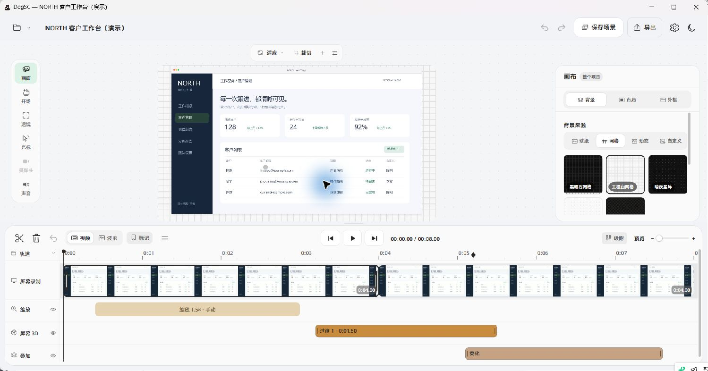

# DogSC Windows

Windows 桌面版。录制屏幕、剪辑、自动运镜与屏幕 3D、导出 MP4 / M4A。界面和流程参考 macOS 版 DogSC，实现是 .NET 8 / WPF，不编译 `Sources/` 里的 Swift。



截图更新于 2026-10-11，使用虚构的 NORTH 客户工作台素材。产品概览见 [根 README](../README.md)，近期功能与界面调整见 [视频功能记录](VIDEO_PARITY.md) 和 [布局核对](VIDEO_LAYOUT.md)。

## 当前界面入口

- **画面**：背景 / 布局 / 外框；背景来源为壁纸、网格、动态和自定义，支持窗口、浏览器、手机和平板外框。
- **开场**：聚拢、侧滑、轻 3D，设置节奏、总时长、元素间隔与参与顺序。
- **运镜**：缩放 / 屏幕 3D，可同时保留两类片段；自动跟随、手动焦点、倾斜、透视和线性柔化在相应属性页调整。
- **光标 / 摄像头 / 声音**：按素材启用；声音可调整全片或单片段，摄像头提供内部构图、镜像与分段同步。
- **预览顶部**：画布比例、原画面裁切、「＋」添加局部效果、预览画质。「＋」提供柔化或突出、导入贴图与粘贴图片，选中时间线片段后编辑属性。
- **时间线**：缩放、屏幕 3D、摄像头运动和叠加效果分轨显示；「轨道」菜单控制显示与收起。

属性标题和画面子页导航固定在滚动区上方；数值胶囊可点击输入，支持实时草稿预览，Enter / 失焦确认，Esc 取消。每次确认合并为一次撤销。

## 能做什么

- 录显示器、窗口、自选区域，或把摄像头 / 采集卡当作主画面
- 同时录麦克风、系统声音，以及一颗摄像头画中画
- 录制条和备忘录使用 DWM 窗口，并请求 Windows 排除采集；本机 gdigrab 采集已验证录制条不入镜。排除失败会记入日志，旧版 Windows / 远程桌面仍需按实际录制核实。倒计时和区域选择在正式录制前关闭
- 录制条左侧把手与备忘录标题栏支持拖动；编辑器可拖动分隔条调整属性栏宽度、时间线高度，打开窗口时适配当前屏幕工作区
- 录制条默认缩小到 85%；右侧箭头收起 / 展开，菜单「工具条大小」可调 70%–110%，也可按住 Ctrl 滚动鼠标滚轮；大小和收起状态会自动记住，收起后仍可暂停、继续和停止录制
- 拖近屏幕边缘松手会自动吸附：上下边缘横排、左右边缘竖排，拖远即可解除；收起和展开固定靠边锚点，根据剩余空间向左或向上展开，整个过程限制在屏幕工作区内，避开任务栏。停靠边缘和展开方向也会记住
- 录制中按 `Ctrl+Alt+M` 打标记，`Ctrl+Alt+S` 停止
- 暂停会另起一段，时间线上接在一起
- 停止后显示完成卡片，可查看首帧缩略图、打开编辑器或定位项目文件夹；缩略图异步生成，关闭卡片会取消生成并清理临时图片
- 编辑器首次打开提供三页引导；设置分为通用、录制、编辑器、权限和关于，支持倒计时关 / 3 秒 / 5 秒和摄像头默认形状，默认场景预设优先。布局重置、引导重播和预览画质切换对打开的编辑器立即生效
- 设置「通用 → 语言」可即时切换中文 / English，选择会保留到下次启动；项目名、路径、设备名和备忘录正文保持原文
- 编辑器里分割、裁短、重排、变速、标记、手动缩放，支持缩略图、波形和边缘吸附
- 按点击生成连续自动运镜：附近点击保持构图，跨区域平滑移动，操作活动延长保持；重新生成保留手动镜头。支持独立进入 / 退出时长、线性 / 五次平滑 / 弹簧 / 二次 / 三次 / 自定义贝塞尔曲线和质量 / 刚度 / 阻尼，预览、光标和成片共用运动轨迹
- 调整光标样式、点击反馈和静止隐藏
- 光标大小、隐藏延迟、点击颜色 / 大小 / 不透明度和独立时间校准；导出按帧采样，跟随裁切、缩放与透视，隐藏模式同时隐藏点击反馈
- 源画面空间裁切、3:4 / 2.39:1 / 1:2.39 和自定义画布比例；暂停选中缩放段可直接查看目标构图
- 画面留白、位置、缩放、圆角、阴影、倾斜、边缘虚化与淡入 / 上移 / 放大开场
- 壁纸、贴图和局部柔化，以及摄像头画中画的形状、位置与进出动画
- 预览顶部「＋」与时间线片段属性支持多张贴图、多个柔化 / 聚光片段；贴图可旋转、调整图层顺序，区域可设置宽高和圆角，默认跟随源画面的裁切、缩放与透视
- 柔化 / 聚光可在预览中直接框选、移动、拖边角缩放与重画；小区域手柄放在外围，支持像素尺寸输入、方向键微调 1 像素、Shift 微调 10 像素和每次拖动独立撤销。暂停时标明「编辑预览」并完整显示所选效果，播放恢复时间线效果
- 每个效果可设起止、无过渡 / 线性 / 平滑过渡及独立淡入淡出时长；时间条可拖动、裁短、吸附，重叠效果自动分行，轨道支持纵向滚动
- 用户场景预设可保存、更新、应用和删除，图片随预设保留，可设为新录制默认场景；跨尺寸应用裁切先显示适配范围。新录制优先使用默认场景，否则沿用上次静态外观；摄像头可独立隐藏、镜像及校准时间
- 复制缩放片段或素材效果，粘贴完整副本或只粘属性，支持撤销 / 重做
- 导出 MP4（原始 / 1080p / 1440p / 4K，30 或 60 帧）或 M4A
- 导出选择随项目保存，显示准备阶段和剩余时间；取消或失败保留旧成片，成功后才替换同名文件

项目保存在「视频 / DogSC」下的 `.dogscproject` 文件夹，使用 Windows 项目格式。录制条的「导入 macOS 项目…」可转换屏幕、系统声音、摄像头、麦克风、指针轨迹、录制标记、多贴图、柔化 / 聚光片段和部分剪辑 / 缩放 / 布局设置；未支持的复杂轨道会在迁移摘要中说明。MOV 等素材会尝试用 ffmpeg 转为 H.264，以便在 Windows 预览。具体已补齐和剩余差异见 [功能核对](MAC_PARITY.md)。

已接通独立屏幕 / 摄像头运动、贴图进出动画与边框 / 阴影 / 背景虚化、摄像头分段同步、程序生成和视频背景、剪切缺口恢复、中断录制扫描恢复，以及包含系统声音的源文件导出。运动轨道支持拖动、裁短、独立复制及只粘属性，并随素材删剪和变速同步。暂停选中运动时直接预览目标构图，屏幕 X/Y 旋转使用透视网格，自定义曲线与 0–2 透视强度可编辑。当前成片运动按 15Hz 分段逼近，摄像头圆角遮罩尚不随布局连续变形；Mac 连续指针控制器、录制恢复日志和 iOS 设备镜像仍待补齐。

逐项差异、源码证据及建议补齐顺序见 [Windows 与 macOS 功能核对](MAC_PARITY.md)。

录制过程中保存恢复日志，并每秒写出视频分片。程序被强制结束后，启动时会扫描中断项目，恢复已提交的画面与标记，并保留录制来源和帧率；最后尚未提交的短片段可能丢失。正常停止和恢复时均无损整理视频封装，以便编辑器预览与跳转。

## 效果复用与快捷键

选中缩放段后，`Ctrl+C` 复制其倍数、焦点、时长、曲线和过渡参数，`Ctrl+V` 创建独立副本。鼠标在时间线上时优先粘到鼠标位置，离开时间线时使用播放头；靠近其他缩放的边缘会吸附。空白不足或位置已被占用时会显示提示，原有缩放保持不变。缩放副本可跨编辑窗口粘贴。

`Ctrl+Shift+V` 只向所选缩放粘贴倍数、焦点、曲线和过渡参数，保留目标的位置和时长。选中素材时，同一组按钮 / 快捷键复用该素材的效果包；画布、画中画和音量是项目级设置，粘贴会影响整个项目，装饰图片的效果包限当前项目使用。

- `Space`：播放 / 暂停
- `S`：在播放头分割；`Delete`：删除所选素材或效果片段；`M`：添加标记
- `Ctrl+Z`：撤销；`Ctrl+Y` 或 `Ctrl+Shift+Z`：重做

选中贴图、柔化或聚光片段时，同样支持完整副本和只粘属性；只粘属性保留目标的开始和持续时间。贴图副本会复制图片进目标项目，可跨编辑窗口使用；全片素材效果包仍限当前项目。旧版单效果项目会自动迁移到多效果格式（schema 2）。

在名称等文本输入框内，保留正常的文字编辑快捷键。

录制条菜单支持上下方向键切换、Enter 选择、Escape 关闭。素材选中后显示裁剪把手，拖动过程中按 Escape 可取消。连续调整滑块合并为一次撤销，编辑期间合并保存，松开滑块、关闭编辑器和导出前写入项目。

录制条松手吸附、横竖排列切换与收起展开使用减速过渡，按钮和文字稍后淡入，展开箭头平滑转向；中途拖动或反向切换会从当前尺寸接续。窗口随内容同步调整，过渡期间也限制在屏幕工作区内。菜单与编辑器属性面板切换使用淡入；关闭 Windows 的界面动画后，这些过渡也会关闭。Windows 版不检查 macOS 发布版本，也不显示相关更新提示。

贴图可直接在预览中拖动，按原比例拖边角缩放，并用顶部手柄旋转；Shift 旋转吸附 15°，Alt + 点击切换重叠图层，Tab 切换贴图。方向键移动 1 个成片像素，Shift + 方向键移动 10 个像素。小贴图的手柄在外围，中心仍能拖动；拖动按画布边缘和中线吸附，旋转后的四角也保持可见。

点选摄像头显示画中画设置，外框支持直接移动和边角缩放，提供方形、横向、纵向、原比例和圆形蒙版。勾选“调整内部画面”后，拖动画面改变构图，内部放大不会改变外框；构图位置按镜像后的视觉方向解释，预览与导出保持一致。

## 运行

需要 [.NET 8 SDK](https://dotnet.microsoft.com/download/dotnet/8.0) 和 [ffmpeg](https://www.gyan.dev/ffmpeg/builds/)（含 ffprobe）。ffmpeg 要在 PATH 里，或在应用设置中指定 `ffmpeg.exe`；把 `ffmpeg.exe` / `ffprobe.exe` 放到应用目录下也能被自动找到（`FfmpegTools.Candidates` 会查 `AppContext.BaseDirectory` 与 `DOGSC_FFMPEG` 环境变量）。

```powershell
dotnet run --project windows/src/DogSC.App
```

自检会生成测试素材，验证组合效果导出、颜色和透视边缘、取消保留旧文件、Mac MOV / 指针 / 标记迁移，再抓 1 秒屏幕，结束即清理临时文件：

```powershell
dotnet run --project windows/src/DogSC.App -- --self-test
```

核心时间线和导出图的测试：

```powershell
dotnet test windows/tests/DogSC.Core.Tests
```

录制恢复回归检查会短暂采集桌面左上角 320×180 区域，测试暂停 / 继续、强制结束后的 FFmpeg 清理、标记恢复及预览；所有录制文件在结束后删除，设置恢复原值：

```powershell
dotnet run --project windows/tests/DogSC.UiChecks -- --recording-recovery
```

## 发布

推 `v*` tag 会触发 `.github/workflows/windows.yml`：在 `windows-latest` 上 restore → build → test → `dotnet publish`（win-x64、依赖框架），跑发布产物的 `--self-test`，最后把 zip 挂到 release draft。CI 里只借一份 ffmpeg essentials 跑自检，zip 不分发 ffmpeg——发布说明里引导用户自备。本地复现构建：

```powershell
dotnet publish windows/src/DogSC.App/DogSC.App.csproj -c Release -r win-x64 --self-contained false -o artifacts/publish
# 验证产物
& artifacts/publish/DogSC.exe --self-test
```

## 权限

Windows 桌面程序不需要单独的“屏幕录制”授权。第一次使用麦克风或摄像头时，系统可能会弹出隐私提示。系统声音走的是当前播放设备的回环，没有在播放的声音就是静音。

左侧、画布子页和预览工具栏图标参考原仓库 SF Symbols，以 Windows 矢量实现。背景分类和缩略图、开场元素顺序、运动焦点缩略图、光标动态预览、选区浮动柔化工具条及顶部预览选项均已接通。字体、抗锯齿、连续圆角与部分动画细节仍有平台差异；逐项状态见 [布局核对](VIDEO_LAYOUT.md)。
